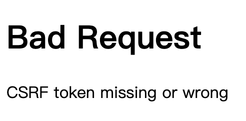
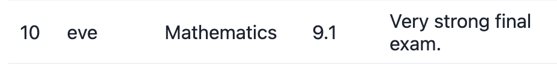

# CSRF Fix — NotesApp Flaw #11

## Before the fix

A review of commit `de9b854` showed that the grade handler checked the user's teacher role and then saved the submitted grade. The teacher form had no CSRF token field, and the server accepted grade updates based on the authenticated session alone.

## Fix

NotesApp generates a token from 32 random bytes and stores it in the session. The teacher grade form and the administrator forms for adding users, deleting users, and running Ping each include the token in a hidden field. A Flask request hook checks the submitted token against the session value before the protected POST handler runs. Requests with a missing or invalid token receive HTTP 400. Login is exempt, and the session cookie uses `SameSite=Lax` as an additional safeguard.

## Verification

I left the teacher form open, signed out, and signed back in from another tab. Submitting the old form returned **400 Bad Request** with the message `CSRF token missing or wrong`. After reloading the teacher page, note 10 still showed **9.1** and `Very strong final exam.` The Flask tests also verified that invalid submissions were rejected before any database call.

The current teacher form saved note 10 with its original grade and comment. In the administrator interface, creating a test student succeeded, and Ping to `127.0.0.1` reported one reply with no packet loss. The automated suite also covered deleting a user. After rebuilding the Web container, all 35 tests passed, including five CSRF tests and eight PostgreSQL integration tests. The running app returned `ok` from `/healthz`.

[Class 11 lab instructions](https://kristenpire.github.io/epita-security-labs/class11/csrf/)
