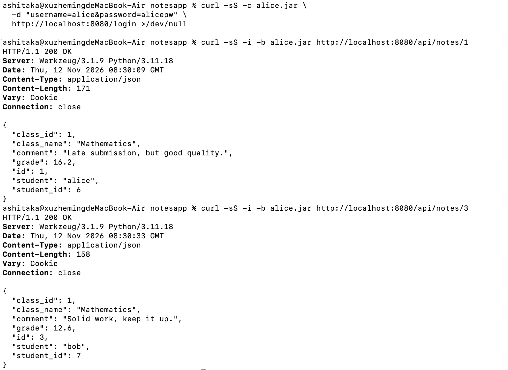
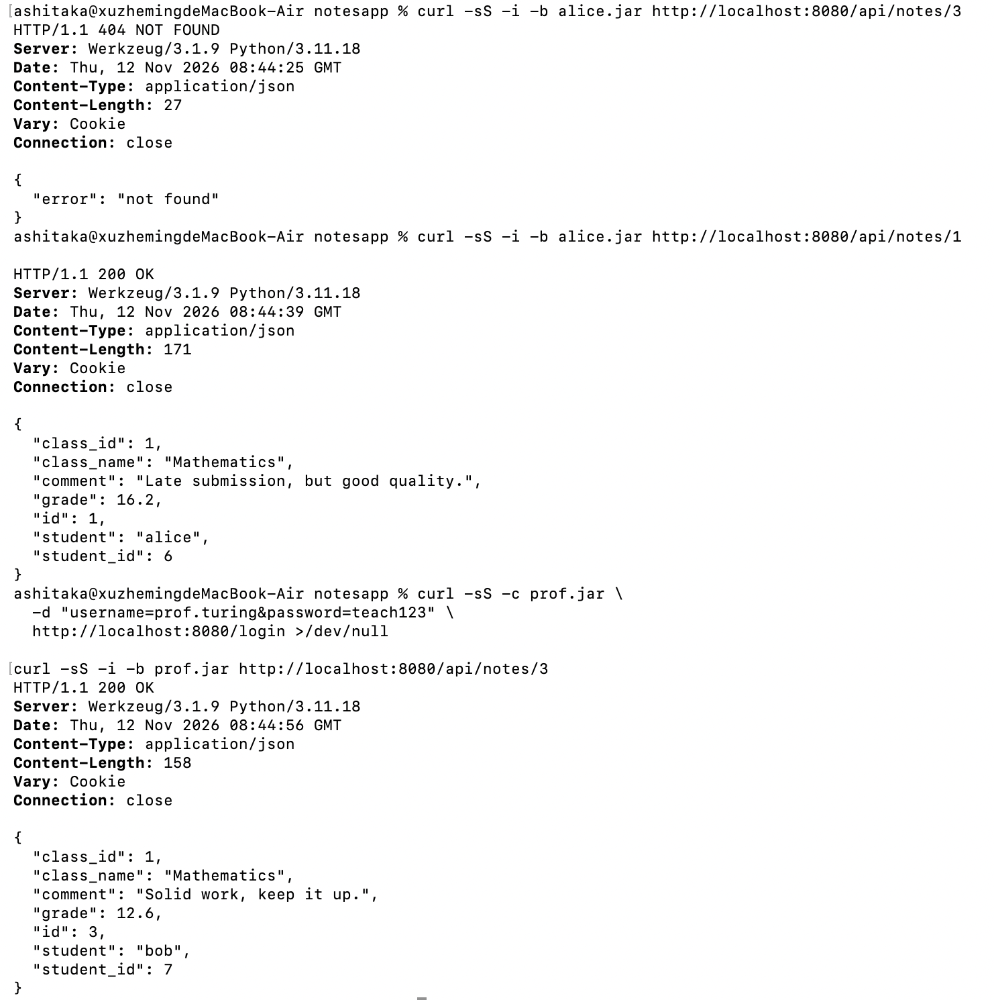

# IDOR FIX - NotesApp flaw #7

Class 8 - Access control | EPITA Computer Security | 12 November 2026

Scope: the local NotesApp clone at `http://localhost:8080`, using the lab seed accounts and grades.

## 1. Prediction and proof of unauthorized access

Before testing, I predicted that changing the note ID in the URL would let Alice read another student's grade.

I logged in as `alice` and saved her session in `alice.jar`. Using that same session, I requested `/api/notes/1` and `/api/notes/3`.

| Caller | Request | HTTP status before the fix | Observed data |
|---|---|---|---|
| alice | `/api/notes/1` | 200 OK | Alice's note; `student_id: 6`, grade **16.2**; "Late submission, but good quality." |
| alice | `/api/notes/3` | 200 OK | Bob's note; `student_id: 7`, grade **12.6**; "Solid work, keep it up." |

The second request confirms IDOR: an authenticated Alice could read a note owned by Bob.



Figure 1 preserves the original terminal screenshot. The login, `alice.jar`, request paths, HTTP 200 responses, owners, grades, and comments are visible.

## 2. Cause and fix

Authentication answers who the caller is. Authorization decides which objects that caller may access. The original `api_notes` handler checked the first question but did not check note ownership.

The fix compares `note["student_id"]` with `ident["user_id"]`. The owner, a teacher, or an admin may read the note. Other authenticated callers receive **404 Not Found** with `{"error":"not found"}`. This is the same response used for a missing note. The check runs before decrypting the comment or returning the grade.

The comparison uses the student's user ID, not the note ID. For example, Alice owns note 1 but her user ID is 6.

### Complete fixed function

The following function matches the current `web/app.py` exactly.

```python
@app.route("/api/notes/<int:note_id>")
def api_notes(note_id):
    ident = current_identity()
    if not ident:
        return jsonify({"error": "unauthorized"}), 401
    conn = get_db()
    cur = conn.cursor()
    # Note ownership is checked below; teachers and admins may read any note.
    cur.execute(
        "SELECT n.id, n.student_id, n.class_id, n.grade, n.comment, "
        "u.username AS student, c.name AS class_name "
        "FROM notes n JOIN users u ON u.id = n.student_id "
        "JOIN classes c ON c.id = n.class_id WHERE n.id = %s",
        (note_id,),
    )
    note = cur.fetchone()
    conn.close()
    if not note:
        return jsonify({"error": "not found"}), 404

    # Flaw #7 fix: only the owner, a teacher, or an admin may read this note.
    if (
        note["student_id"] != ident["user_id"]
        and ident.get("role") not in ("teacher", "admin")
    ):
        return jsonify({"error": "not found"}), 404

    decrypt_comments([note])
    note["grade"] = float(note["grade"]) if note["grade"] is not None else None
    return jsonify(note)
```

## 3. Verification after rebuilding

After applying the change and rebuilding with `docker compose up -d --build`, I repeated the requests.

| Caller | Request | Observed status | Observed result |
|---|---|---|---|
| alice | `/api/notes/3` | **404 NOT FOUND** | `{"error":"not found"}` |
| alice | `/api/notes/1` | **200 OK** | Alice's own note, grade **16.2**, comment: "Late submission, but good quality." |
| prof.turing | `/api/notes/3` | **200 OK** | Bob's note, grade **12.6**, comment: "Solid work, keep it up." |



The three HTTP outcomes above come from Figure 2. The admin exception is implemented and passed an isolated handler check; an admin HTTP request is not part of the screenshot evidence.

## 4. Hand-in summary

```text
IDOR FIX - NotesApp flaw #7 (broken access control) closed
  Proof you got in:   as alice, /api/notes/3 returned bob's grade:
                     12.6 - "Solid work, keep it up."
  Fix:               api_notes refuses a note whose student_id is not the caller's,
                     unless the caller is a teacher/admin.
  Code chosen:       [x] 404 not found   [ ] 403 forbidden
  Proof it's closed: as alice, /api/notes/3 -> 404, {"error":"not found"}
                     as alice, /api/notes/1 -> 200, alice's own note, grade 16.2
                     as prof.turing, /api/notes/3 -> 200, bob's note, grade 12.6
```

## 5. Verification and evidence integrity

The exact current handler passed Python syntax validation and nine isolated checks: no identity, missing note, another student's note, owner, teacher, admin, unrecognized role, missing role, and owner with a null grade. These checks simulate the database and identity; the HTTP evidence is the original terminal screenshots.

The screenshots are included without cropping or retouching. SHA-256 values of the renamed copies match the originals:

- `01-before-alice-reads-bob.png`: `df81f5030a6122553d024171131e54150f00a0cca576423c96c8d7cc56e62037`
- `02-after-authorization-check.png`: `e3e1c039639d7061f47cdb2e2dd4d0618a491de4a101283bc6b276f6c3a8024f`
