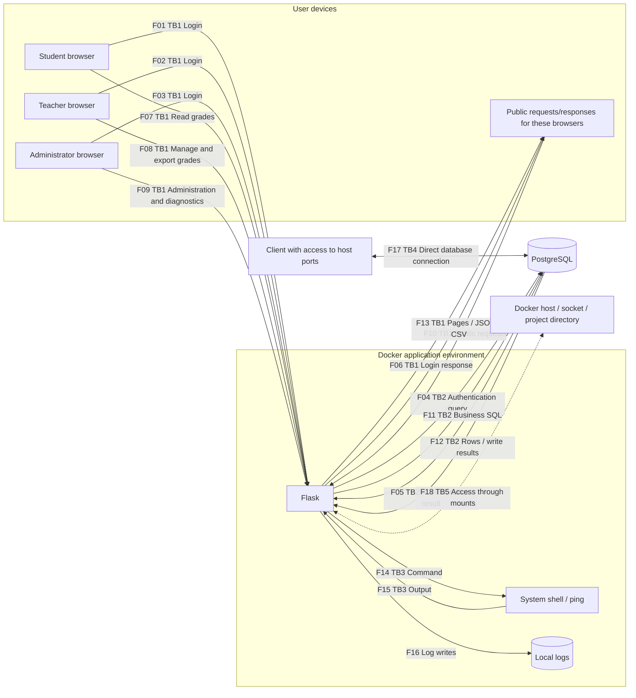
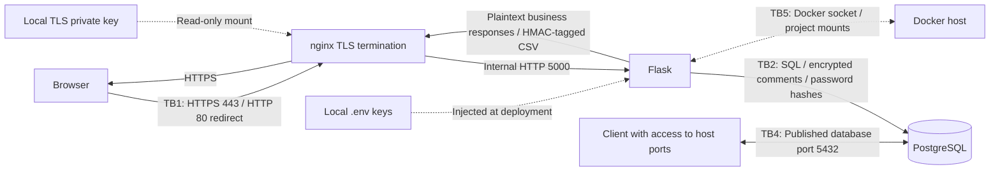

# Project 1 — NotesApp Threat Model and Risk Analysis

Prepared by: Our group. Original analysis date: 2026-10-22. Repository review: 2026-10-27.
The required lab deliverables follow Session 02, slides 33–34. Later course changes are documented separately for context.
The baseline is the original application at fork commit `1c83e42`; changes made for the course are documented separately.
This report combines the supplied threat analysis with a review of the baseline and current repository source. Where we refer to earlier test results, we identify the existing project record. We did not repeat runtime experiments during this document review. **This report does not demonstrate that every vulnerability has been successfully exploited.**

### Session 02 Requirements and Report Locations

| Requirement from slides 33–34 | Where we document it |
|---|---|
| Fork the application and start it with Docker Compose | The project README provides setup instructions; our original application baseline is commit `1c83e42`. This review does not claim a new setup run. |
| Explore pages as a student and then as a teacher | Sections 1 and 3 describe roles and page/request flows, checked against the source. This review does not claim a new browser walkthrough. |
| Draw numbered data flows and mark trust boundaries | Section 2 contains the diagram and boundary definitions; Section 3 lists the sender, receiver, and data for each numbered flow. |
| Ask all six STRIDE questions for each flow | Section 4 contains one row for each flow, F01–F18, with all six STRIDE categories. |
| Keep the diagram and initial STRIDE table for Project 1 | Both deliverables are retained together in this version-controlled Markdown file. |

Sections 2–4 are the Session 02 deliverables. Sections 5–7 provide additional risk analysis, current implementation context, and a proposed presentation outline. The Session 02 task is observation and threat identification; it does not require attack execution.

The diagrams use Mermaid and render in a Markdown viewer that supports Mermaid, including GitHub.

## 1. Assets and Roles

| Asset | Security properties to protect |
|---|---|
| Grades, teacher comments, and student–class associations | Confidentiality and integrity |
| Passwords, session cookies, JWTs, and roles | Authenticity and authorization boundaries |
| Database, application, and Docker host | Availability and least privilege |
| Exported files and activity logs | Integrity and traceability |
| AES/HMAC keys and TLS private keys | Confidentiality and recoverability |

Students should only be able to read their own grades; teachers should only be able to manage their own classes; administrators manage users and classes.
In the actual code, the administrator page only lists classes and has no routes for creating, updating, or deleting them. We therefore distinguish the role description in the slides from the features actually implemented.
External input is untrusted, and having a valid account does not imply permission to access every record.

## 2. Numbered Data Flow Diagram (Original Baseline)

**TB1**: The identity/network boundary between user devices and the application service.
**TB2**: The credential, SQL, and permission boundary between the application process and the database service.
**TB3**: The interpretation boundary where application data becomes a shell command; this does not imply that the shell runs under a separate OS account.
**TB4**: The boundary where Docker services are exposed to external clients through published host ports.
**TB5**: The privilege boundary between the container and the Docker host.
F16 is a persistent data flow within the same container. File permissions form an access control boundary, but we do not represent it as a separate network boundary.
F17 represents a bidirectional database protocol exchange. F18 represents a potential channel enabled by configuration; **the Docker socket was not used during the experiments**.

## 3. Data Flow Inventory and Source Code Evidence

| ID | Sender → receiver; data crossing the boundary | Code location (function names to avoid line-number drift) |
|---|---|---|
| F01 | Student → Flask; POST /login, username/password | `web/app.py:login` |
| F02 | Teacher → Flask; the same login form | `login` |
| F03 | Administrator → Flask; the same login form | `login` |
| F04 | Flask → DB; a SELECT query constructed by concatenating the username and, in the original baseline, the password | `login` |
| F05 | DB → Flask; baseline: user ID, username, and role | `login` |
| F06 | Flask → browser; login HTML, an error or 302 response, and a signed session cookie; the JWT is stored in the session | `login`, `make_jwt` |
| F07 | Student → Flask; GET /dashboard, GET /api/notes/id, cookie or Bearer JWT | `dashboard`, `api_notes` |
| F08 | Teacher → Flask; GET /teacher, GET /export.csv?class_id=…, POST /grades with IDs, grades, and comments | `teacher`, `export_csv`, `grades` |
| F09 | Administrator → Flask; GET /admin, POST /admin/users with user fields, POST /admin/ping with a host value | `admin`, `admin_users`, `admin_ping` |
| F10 | Browser → Flask; GET /, /login, /logout, /healthz, /static/style.css | `index`, `logout`, `healthz`, Flask static |
| F11 | Flask → DB; grade/class/user queries, grade and user creation/update/deletion, and connection health checks | `get_db` and the relevant business functions |
| F12 | DB → Flask; grades, comments, classes, user lists, execution results, or exceptions | Same as F11 |
| F13 | Flask → browser; pages, role badges, plaintext business JSON/CSV, errors, and redirects; JWT in dashboard JavaScript | Templates, `api_notes`, `export_csv` |
| F14 | Flask → shell/ping; a command constructed using the host value; ping may then send ICMP traffic to the specified host | `admin_ping` |
| F15 | shell/ping → Flask; standard output, errors, or timeout information, subsequently returned through F13 | `admin_ping` |
| F16 | Flask → log file; login events, grade operations, and diagnostic records | `log`, `web/Dockerfile` |
| F17 | Network client ↔ DB; port 5432 published by the original Compose configuration, database authentication, and SQL | `docker-compose.yml:db.ports` |
| F18 | Flask container ↔ host; access to the Docker socket API and project files | `docker-compose.yml:web.volumes` |

## 4. Initial STRIDE Table (Six Categories Checked for Each Flow)

S = Spoofing, T = Tampering, R = Repudiation, I = Information disclosure, D = Denial of service, E = Elevation of privilege.
The table describes potential threats. “No direct action” means that the flow itself does not perform the relevant sensitive operation; it does not mean that the whole system is secure.

| Flow | S | T | R | I | D | E |
|---|---|---|---|---|---|---|
| F01 | Guess or steal a student password | Modify login fields | Insufficient attribution of login events | HTTP exposes passwords | No rate limit allows resource exhaustion | Gain unauthorized access through a weak token later in the chain |
| F02 | Impersonate a teacher | Modify login fields | A teacher denies logging in | Password/session exposure in transit | Repeated authentication consumes resources | Obtain teacher write permissions |
| F03 | Impersonate an administrator | Modify login fields | Insufficient attribution of administrative operations | Exposure of administrator credentials | Repeated authentication | Obtain administrator permissions |
| F04 | Shared DB credentials provide an overly broad identity | Concatenated SQL changes query semantics | No separate DB audit trail | Exceptions expose SQL details | Expensive or abnormal queries | Queries exceed their authentication purpose |
| F05 | A replaced/compromised DB returns a false identity | Modify the returned role | No independent provenance for results | Exposure of identity fields | An unresponsive DB leaves requests waiting | Accept a malicious role value |
| F06 | A weak session secret enables identity forgery | Modify HTTP responses in transit | No independent, protected proof of login issuance | Cookie/JWT exposure in transit | Block responses | Forge a session with a different role |
| F07 | The API accepts unsigned JWTs | Change record IDs | No audit trail for individual record reads | The API does not check grade ownership | Requests without pagination/rate limits | An ordinary user bypasses record permissions |
| F08 | Use a stolen teacher session | Write arbitrary record IDs; missing CSRF protection | Logs omit old/new values | Read/export data across all classes | Large exports/comments consume resources | Teacher–class ownership is not checked |
| F09 | Use a stolen administrator session | Administrative forms lack CSRF protection | User creation/deletion lacks business-level logging | Exposure of user and class data | Repeated diagnostic/administrative requests | The host value enters a shell command |
| F10 | A fake site induces login | Modify CSS/pages in transit | No separate audit trail for logout/health checks | The health endpoint returns DB errors directly | Repeated health checks open DB connections | No direct authorized write operation in this public flow |
| F11 | A shared DB identity does not distinguish users | The DB role can modify too much data | No business-level DB audit trail | Queries have an overly broad scope | Exhaust DB connections/locks | No record/class scope restrictions |
| F12 | A compromised DB returns false results | Modify grades/comments | No historical signatures for results | Read plaintext grades/comments | Large result sets consume memory | Malicious comments become scripts when rendered |
| F13 | Fake responses/exports impersonate the server | Original CSV lacks authentication; comments are not escaped | The origin of original exports cannot be proven | Display other students' grades; expose JWTs to JavaScript | Large result sets consume browser resources | Stored XSS uses the logged-in user's permissions |
| F14 | Execute using a stolen administrator identity | Concatenate the host value into a shell command | Diagnostic logs cannot prove the full effects of a command | Commands read files/secrets | Subprocesses and network requests exhaust resources | Execute arbitrary commands in a root container |
| F15 | A controlled subprocess returns false output | Forge output content | No independently protected record links output to an execution | Command output exposes sensitive information | Large output consumes memory | Output is escaped text and does not directly execute |
| F16 | Forge the identity recorded in an event | File permissions allow modification | Logs can be deleted/modified and omit full change values | Exposure of usernames/diagnostic information | No log rotation allows disk exhaustion | Logs do not directly grant permissions |
| F17 | Known DB credentials allow DB user impersonation | Bypass the application and modify the DB directly | No application-level activity records | Read passwords and comments directly | Exhaust SQL/connection resources | The database initialization account has excessive privileges |
| F18 | The container impersonates a trusted host client | Modify the mounted project/control containers | Host operations are not attributed to business users | Exposure of host files/other containers' data | Control or stop other containers | The Docker socket crosses container isolation |

## 5. Risk Scoring

Our scores provide a **qualitative ranking of the original application exposed through the default Compose configuration**, rather than statistics on attack frequency.
L (likelihood): 1 = substantial prerequisites, 2 = requires conditions such as an account or network reachability, 3 = low barrier to entry.
I (impact): 1 = minor local impact, 2 = one account or part of the application, 3 = bulk sensitive data, critical write permissions, or the host.
R = L × I; 1–2 = low, 3–4 = medium, 6–9 = high. For equal scores, we prioritize attack-chain entry points and the scope of impact.

| ID | STRIDE / flow | Specific threat | L | I | R | Recommended mitigation |
|---|---|---|---:|---:|---:|---|
| R01 | T/E, F04 | Concatenated SQL changes the login query | 3 | 3 | 9 | Parameterized SQL and least-privilege DB permissions |
| R02 | S/E, F06–07 | Unsigned JWTs / weak signing secrets enable identity forgery | 3 | 3 | 9 | Fix the allowed algorithms; validate signatures and time claims; use strong random keys |
| R03 | I/E, F07–08, F11–13 | API/teacher reads and writes do not check resource ownership | 3 | 3 | 9 | Check student or teacher relationships with classes/records on every access |
| R04 | I/S, F01–06 | HTTP allows password and session theft | 2 | 3 | 6 | HTTPS, certificate validation, and closure of bypass ports |
| R05 | I, F12, F17 | A stolen database directly exposes passwords/comments | 2 | 3 | 6 | Argon2id for passwords; AES-GCM for comments; store keys separately from backups |
| R06 | T/E, F12–13 | Stored XSS in comments | 2 | 3 | 6 | Preserve template escaping and explicitly allowlist any permitted rich text |
| R07 | T/E, F14, F18 | Administrative command injection combined with host socket access | 2 | 3 | 6 | Avoid the shell, validate arguments, remove the socket mount, and run as non-root |
| R08 | T, F08–09 | CSRF triggers grade or user changes | 2 | 3 | 6 | CSRF tokens, Origin checks, and appropriate cookie policies |
| R09 | R, F16 | Modified/missing logs prevent changes from being traced | 2 | 2 | 4 | Protect audit logs; record the actor, target, and before/after values |
| R10 | D, F01, F10–11, F16 | Authentication, DB access, exports, or logs exhaust resources | 2 | 2 | 4 | Rate limits, size limits, timeouts, pagination, and log rotation |
| R11 | T/R, F13 | Recipients cannot verify whether a CSV has been modified | 2 | 2 | 4 | HMAC and a trusted verification tool; use digital signatures when public verification is required |
| R12 | I/T/E, F17 | Abuse of the published DB port and known teaching credentials | 2 | 3 | 6 | Do not publish the DB port; restrict network/account permissions and replace credentials |

### Top Three: Priority Fixes and Acceptance Criteria

1. **R01 — SQL injection**: Parameterize the username query. Acceptance criteria: special characters are treated literally and legitimate login still works.
   This is a priority risk in the original baseline. In the current repository, `login()` already uses a parameterized username query and separate password verification. We retain R01 as a baseline finding rather than claiming it is still present in the current login query; runtime acceptance checks were not repeated during this review.
2. **R02 — Identity forgery**: Reject `alg:none` and strictly validate the algorithm, signature, and validity period. Acceptance criteria: unsigned, expired, and incorrectly signed tokens are all rejected.
   This issue remains unresolved in the current source: `verify_jwt()` accepts `alg:none` without checking a signature. This threat-model review does not claim a successful token-forgery experiment.
3. **R03 — Unauthorized resource access**: Apply consistent record/class ownership checks to the API, teacher lists, updates, and exports. Acceptance criteria: roles/classes are isolated while legitimate access continues to work.
   This issue remains unresolved in the current source. We identify it from the missing ownership checks; this review does not claim a runtime probe of another student's records.

## 6. Current Repository Changes and Remaining Risks

The following diagram describes the optional HTTPS configuration started with `docker-compose.yml` and `docker-compose.https.yml`. The default configuration still exposes HTTP on host port 8080. Both configurations retain the published database port and host/socket mounts from the base Compose file.

| Control | Implementation or recorded evidence | Limitation |
|---|---|---|
| AES-GCM for comments | `web/comment_crypto.py` uses AES-256-GCM with a fresh 12-byte nonce and the fixed AAD `notesapp:notes.comment:v1`. [The AES-GCM lab record](AES_GCM_LAB.md) records 60 migrated comments and 15 passing tests. | AAD authenticates the format/field context, not a record ID; moving valid ciphertext between records is not prevented. Grades/names remain unencrypted, and the running application can decrypt comments. |
| HMAC for exports | `export_csv()` appends an HMAC-SHA256 tag; `verify_export.py` verifies the exact CSV bytes. The AES-GCM lab record also records a passing CSV HMAC check. | Contents remain plaintext; valid old files can be replayed. Verification requires the shared secret and does not provide independent non-repudiation. |
| Optional HTTPS | The HTTPS override removes the web service's published port 8080 and adds nginx on ports 80/443. nginx terminates TLS and redirects HTTP to HTTPS. | Requires starting the override configuration; the default remains HTTP. The self-signed certificate needs local trust. Ports 80/443 are not restricted to loopback in this configuration. No packet capture was verified during this review. |
| Argon2id and parameterized login | `login()` uses a parameterized username lookup, verifies Argon2 passwords, and migrates legacy plaintext passwords after successful login. `admin_users()` hashes passwords for new accounts. | Legacy users who have not successfully logged in retain plaintext passwords; weak passwords remain guessable. Runtime migration checks were not repeated during this review. |
| Infrastructure exposure | The base Compose file still publishes DB port 5432 and mounts the Docker socket and project directory into the web container. The HTTPS override does not remove these settings. | R07/R12 and the TB4/TB5 exposure remain relevant. We found no separate isolation override implementing the restrictions claimed in the supplied draft. |

Key files must not be committed to Git. The application environment, host access, and key backups become additional assets that we need to protect.
The parameterized login query addresses the baseline R01 injection path, but R02 (weak JWT/session authentication) and R03 (resource ownership checks) remain unresolved. Other baseline findings must be assessed against the current configuration rather than treated as automatically fixed. We do not describe this repository as ready for production.

## 7. Proposed Three-Minute Group Presentation Outline

- 0:00–0:40: Introduce the system roles and three main asset categories: grades, comments, and credentials. Explain the limits of the implemented administrator class-management features.
- 0:40–1:20: Present the numbered data flows and TB1/TB2, then cover the shell, direct DB access, and host mount boundaries.
- 1:20–2:15: Explain STRIDE and L × I, highlighting SQL injection, token forgery, and unauthorized record access as the three priority risks.
- 2:15–3:00: Present the current encryption/HMAC/HTTPS/Argon2 implementation and the recorded AES-GCM lab results. Distinguish source inspection from runtime verification, and explain remaining vulnerabilities and the limitations of self-signed certificates.

This is a proposed presentation outline; we do not claim that the classroom presentation has already taken place.
